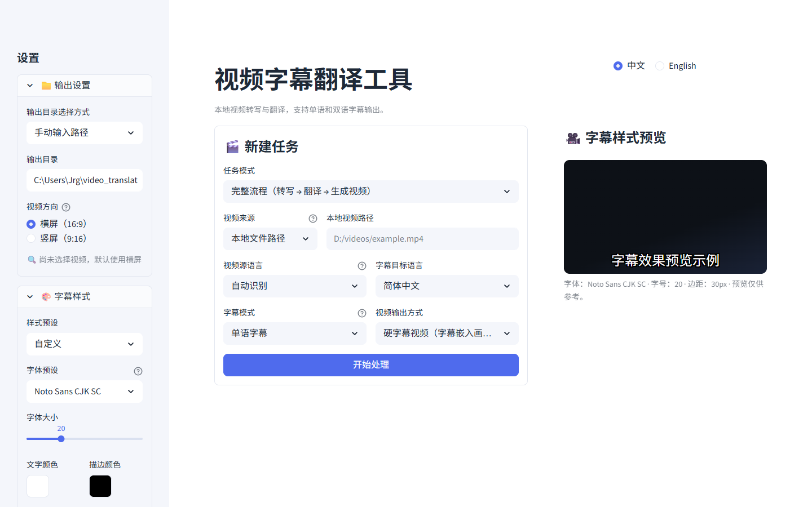
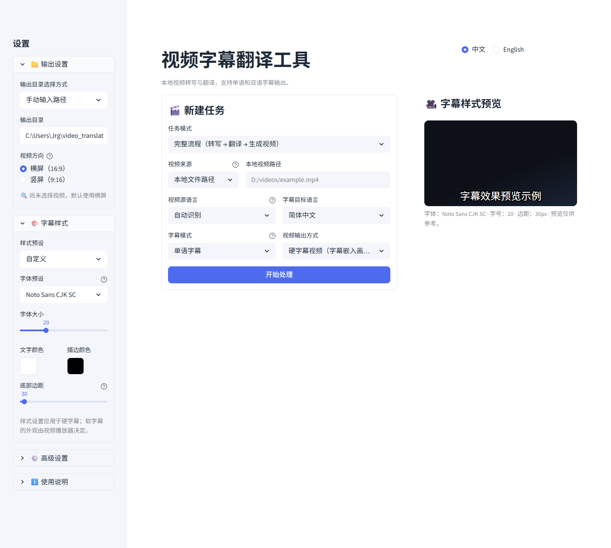
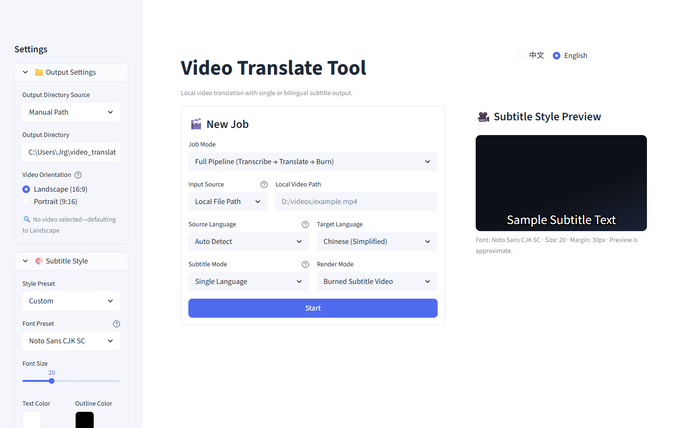

# video-translate-tool 视频字幕翻译工具

本地运行的视频处理工具，一站式完成 **语音转写 → 字幕翻译 → 生成 SRT → 烧录字幕视频**。

- 基于 `faster-whisper` 进行语音识别，自动选择 GPU / CPU
- 基于 DeepSeek API 并发批量翻译字幕
- 支持单语 / 双语字幕、硬字幕 / 软字幕输出
- 提供 Streamlit 网页界面，支持中英文界面切换和字幕样式实时预览

## 效果展示

### 主界面

主区域的“新建任务”卡片集中了每次都要用到的选项：任务模式、视频、语言和输出方式；右侧实时预览字幕样式。



### 完整设置项

侧边栏按“输出设置”“字幕样式”“高级设置”“使用说明”分组，不常用的高级选项（Whisper 模型、翻译批次与并发数、详细日志）默认折叠。

<details>
<summary>点击展开完整页面截图</summary>



</details>

### 英文界面

点击右上角的 **中文 / English** 即可切换界面语言，已填写的设置和任务结果会保留。



### 双语字幕输出示例

双语模式下，第一行为原文，第二行为目标语言译文（以下为示意内容）：

```srt
1
00:00:00,000 --> 00:00:03,200
Welcome back to the channel.
欢迎回到本频道。

2
00:00:03,200 --> 00:00:06,800
Today we're going to talk about subtitles.
今天我们来聊聊字幕。
```

## Windows 一键启动

完成下方依赖安装后，双击项目根目录的 **`start.cmd`** 即可启动网页界面，无需输入启动命令。

- 脚本优先使用项目内的 `.venv` / `venv`，否则使用系统的 `python` 或 `py -3`，要求 Python 3.10 或更新版本。
- 浏览器会自动打开；如果未打开，访问 `http://localhost:8501`。
- 使用期间保留命令窗口，关闭窗口即可停止服务。不要重复启动多个窗口。
- 缺少 Python 或依赖时，窗口会保留并显示提示。FFmpeg 和 API Key 仍按下方说明配置。
- 该脚本仅监听本机地址，适合在自己的电脑上使用。

## 界面语言

页面右上角提供 **中文 / English** 切换，默认显示中文。切换后，界面标签、选项、帮助说明、进度状态和下载按钮会同步更新，并保留当前已输入的设置、上传视频和任务结果。界面语言与视频源语言、字幕目标语言相互独立；切换界面语言不会重新运行任务。

此功能要求 Streamlit 1.55.0 或更新版本，以确保切换文案时保留控件状态。已有环境请重新运行 `pip install -r requirements.txt`。底层技术日志、第三方错误和 Streamlit 上传组件内置提示保留原文，便于排查问题。

## 安装

```bash
pip install -r requirements.txt
```

系统 `PATH` 中需要能找到 FFmpeg。

在项目根目录创建 `.env` 文件：

```env
DEEPSEEK_API_KEY=your_api_key_here
```

## Linux 部署

### 系统依赖

```bash
# FFmpeg 和 ffprobe
sudo apt install -y ffmpeg

# 中日韩字体，用于硬字幕渲染
sudo apt install -y fonts-noto-cjk

# 音频解码库
sudo apt install -y libsndfile1
```

### 方式 A：直接部署（单机 / 局域网）

```bash
python3 -m venv .venv
source .venv/bin/activate
pip install -r requirements.txt

cp .env.example .env
# 填写 DEEPSEEK_API_KEY

streamlit run app.py --server.port 8501 --server.address 0.0.0.0
```

如需作为常驻后台服务运行，将 `video-translate.service` 复制到 `/etc/systemd/system/`，修改其中的 `User` 和 `WorkingDirectory` 字段，然后执行：

```bash
sudo systemctl daemon-reload
sudo systemctl enable video-translate
sudo systemctl start video-translate
```

### 方式 B：Docker（推荐用于生产环境）

```bash
cp .env.example .env
# 填写 DEEPSEEK_API_KEY

docker compose up -d
```

启动后访问 `http://<服务器IP>:8501`。

输出文件会持久化到宿主机的 `./outputs/` 目录。Whisper 模型权重缓存在 Docker 命名卷中，容器重启后不会丢失。

## 运行方式

### 命令行脚本

```powershell
# 最简用法：自动识别源语言，生成中文硬字幕视频
python transfer_video_burn.py path/to/video.mp4

# 指定目标语言、双语字幕和输出目录
python transfer_video_burn.py path/to/video.mp4 --target-language en --subtitle-mode bilingual --output-dir my_outputs
```

输出默认写入项目目录下的 `outputs/`。运行 `python transfer_video_burn.py --help` 查看全部参数。

### Streamlit 网页界面

```powershell
streamlit run app.py
```

## 任务模式

侧边栏的 **任务模式** 提供两种运行方式：

### 完整流程（转写 → 翻译 → 烧录）

默认模式，端到端执行完整流程：

1. **转写**：Whisper 从视频音频中提取语音和逐词时间戳。
2. **翻译**：DeepSeek 以并发批次翻译字幕片段。
3. **生成 SRT**：将字幕切分为带时间轴的片段并写入 `.srt` 文件。
4. **烧录**：FFmpeg 渲染带字幕的视频（支持 NVENC 时自动使用 GPU 加速）。

### 使用已有 SRT 烧录字幕

完全跳过转写和翻译。适用于手动修改生成的 `.srt` 文件后重新渲染视频，无需重跑整个流程，渲染通常在 10 秒内完成。

**使用流程：**

1. 先运行 **完整流程**，生成初始的 `.srt` 文件和视频。
2. 用任意文本编辑器打开 `.srt` 文件并修正内容。
3. 将 **任务模式** 切换为 **使用已有 SRT 烧录字幕**，SRT 路径会自动填入上一次的结果。
4. 点击 **开始处理**，FFmpeg 会使用修改后的字幕重新渲染视频。

## 输入与输出

视频来源支持两种方式：

- **本地文件路径**
- **上传文件**

**上传文件** 支持最大 2GB 的视频。处理更大的视频或在本机日常使用时，推荐使用 **本地文件路径**。

输出目录支持两种选择方式：

- **手动输入路径**
- **浏览文件夹**

**浏览文件夹** 会打开系统的文件夹选择对话框。如果当前环境不支持桌面对话框（如服务器部署），请使用 **手动输入路径**。

## GPU 加速

### Whisper 转写

转写使用 `faster-whisper`，推理引擎为 CTranslate2，不依赖 PyTorch。启动时检测到支持 CUDA 的 GPU 会以 `float16` 模式运行；在 CPU 上则使用 `int8` 量化，速度仍明显快于原版 `openai-whisper`。

### FFmpeg 视频渲染

烧录步骤会自动检测本机 FFmpeg 是否支持 `h264_nvenc`（NVIDIA 硬件编码器）。支持时使用 NVENC 进行 GPU 加速渲染，否则回退到 `libx264`（CPU）。

2 分钟视频的典型渲染耗时：

| 编码器 | 耗时 |
|---|---|
| `libx264`（CPU） | 约 36 秒 |
| `h264_nvenc`（GPU） | 约 5 秒 |

## 翻译设置

### Whisper 模型

| 模型 | 速度 | 准确度 |
|---|---|---|
| `tiny` | 最快 | 最低 |
| `base` | 快 | 较低 |
| `small` | 均衡（默认） | 良好 |
| `medium` | 慢 | 较好 |
| `large` | 最慢 | 最好 |

### 翻译并发数

控制同时发送给 DeepSeek API 的翻译批次数量，默认为 `3`。数值越大，长视频的翻译耗时越短，但可能触发 API 限流。

### 每批翻译条数

每次翻译请求包含的字幕片段数量，默认为 `10`。

## 语言支持

字幕目标语言支持：

- 简体中文
- 英语
- 日语
- 韩语

界面同时提供 **视频源语言** 选项，默认为 **自动识别**，使用 Whisper 的语言检测功能。

- 手动选择的源语言会作为 Whisper 的识别提示。如果与 Whisper 实际检测结果不一致，后续处理以检测结果为准。
- 双语模式下，第一行保留原文字幕，第二行为所选目标语言的译文。
- 源语言与目标语言相同时，双语输出会自动降级为单语字幕，避免重复显示。
- 源语言与目标语言相同时，会跳过翻译步骤，直接使用 Whisper 转写文本，节省 API 费用。
- 非中文目标语言采用较简单的首轮切分策略，优先保证稳定性和字幕长度的可读性。
- 软字幕输出会根据所选目标语言写入字幕语言元数据。

## 字幕样式

侧边栏支持以下字幕样式设置：

- 样式预设（Netflix、YouTube、Bilibili、经典电影、自定义）
- 字体预设
- 自定义字体名称
- 字体大小
- 文字颜色
- 描边颜色
- 底部边距
- 视频方向（自动识别横屏 16:9 / 竖屏 9:16）
- 实时字幕样式预览面板

以上设置作用于硬字幕；软字幕的外观由视频播放器决定。

双语字幕目前对原文行和译文行使用相同的样式。

如果所选字体未安装在系统中，FFmpeg 可能会使用其他字体代替。界面提供了适合多语言字幕的常用字体预设，也支持按需填写自定义字体名称。

## 功能一览

- 单语字幕
- 双语字幕（原文在上，译文在下）
- 硬字幕视频输出（可用时通过 NVENC 进行 GPU 加速）
- 软字幕视频输出
- 目标语言支持中文、英语、日语、韩语
- faster-whisper 转写，自动选择 GPU / CPU
- 并发批量翻译，减少 API 等待时间
- 仅烧录模式：修改 SRT 后直接重新渲染，无需重跑完整流程
- 中文 / English 界面切换

## 已知问题

### Docker 中的 GPU 加速

当前 `Dockerfile` 使用轻量基础镜像 `python:3.11-slim`，不包含 CUDA 运行时，因此容器内的 Whisper 转写和 FFmpeg 编码都会在 CPU 上运行。

如需在 Docker 中启用 GPU 加速，请将基础镜像替换为合适的 `nvidia/cuda` 镜像，在宿主机安装 NVIDIA Container Toolkit，并使用 `--gpus all` 运行容器。

这是面向 NVIDIA GPU 服务器环境的计划改进项。

## 许可证

本项目基于 [MIT License](LICENSE) 开源。
